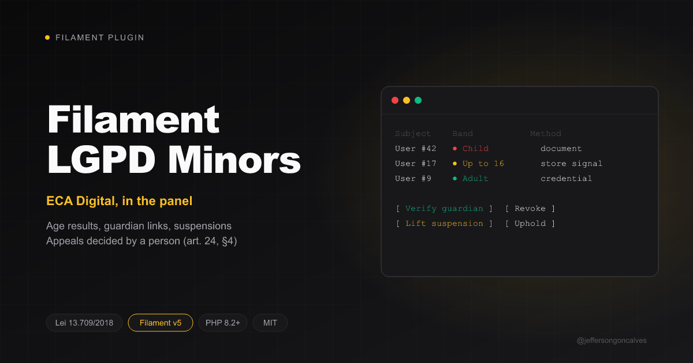

<div class="filament-hidden">



</div>

# Filament LGPD Minors

[](https://packagist.org/packages/jeffersongoncalves/filament-lgpd-minors)
[](https://github.com/jeffersongoncalves/filament-lgpd-minors/actions?query=workflow%3Atests+branch%3A3.x)
[](https://github.com/jeffersongoncalves/filament-lgpd-minors/actions?query=workflow%3A"Fix+PHP+code+styling"+branch%3A3.x)
[](https://packagist.org/packages/jeffersongoncalves/filament-lgpd-minors)
[](LICENSE.md)

Manage the ECA Digital records (Lei 15.211/2025) kept by [laravel-lgpd-minors](https://github.com/jeffersongoncalves/laravel-lgpd-minors) in your Filament panel.

## Features

- **Age checks:** a read-only list of each result, with the age band, the method (marked as reliable or not), the provider and the expiry date. Your app's age check flow records them. Nobody types them in by hand.
- **Guardian links:** link a minor's account to a legal guardian (art. 24), then verify or revoke the link. A link counts only once it is verified.
- **Suspensions:** suspend an account when there are well-founded signs that a minor is using it outside the rules (art. 24, §4). You can record an appeal received by email or support ticket, then lift or uphold the suspension with a written decision. The navigation badge counts the appeals waiting for a decision.
- 19 languages.

## Compatibility

| Plugin Version                                                              | Filament |
|-----------------------------------------------------------------------------|----------|
| [1.x](https://github.com/jeffersongoncalves/filament-lgpd-minors/tree/1.x) | 3.x      |
| [2.x](https://github.com/jeffersongoncalves/filament-lgpd-minors/tree/2.x) | 4.x      |
| [3.x](https://github.com/jeffersongoncalves/filament-lgpd-minors/tree/3.x) | 5.x      |

## Installation

You can install the package via composer:

```bash
composer require jeffersongoncalves/filament-lgpd-minors:"^3.0"
php artisan vendor:publish --tag="lgpd-minors-migrations"
php artisan migrate
```

## Usage

```php
use JeffersonGoncalves\Filament\LgpdMinors\LgpdMinorsPlugin;

public function panel(Panel $panel): Panel
{
    return $panel
        ->plugins([
            LgpdMinorsPlugin::make()
                ->navigationGroup('LGPD')            // default: no group
                ->navigationSort(7)
                ->subjectModel(\App\Models\User::class)  // default: auth.providers.users.model
                ->subjectTitleAttribute('name'),     // shown next to the id and used to search accounts
        ]);
}
```

All fluent methods are optional.

> The resources have no authorization of their own. Register them only on panels whose users handle child safety, or add policies for the `JeffersonGoncalves\LgpdMinors\Models\*` models.

## Testing

```bash
composer test
```

## Changelog

Please see [CHANGELOG](CHANGELOG.md) for more information on what has changed recently.

## Contributing

Please see [CONTRIBUTING](.github/CONTRIBUTING.md) for details.

## Security Vulnerabilities

Please review [our security policy](../../security/policy) on how to report security vulnerabilities.

## Credits

- [Jefferson Gonçalves](https://github.com/jeffersongoncalves)
- [All Contributors](../../contributors)

## License

The MIT License (MIT). Please see [License File](LICENSE.md) for more information.
